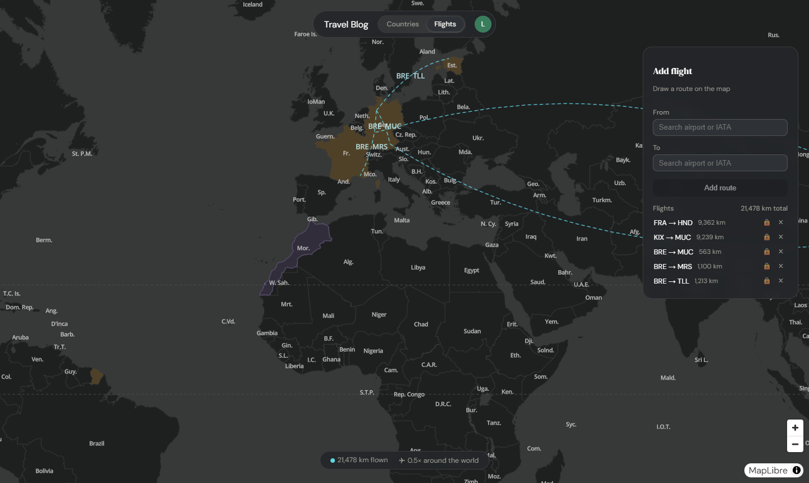
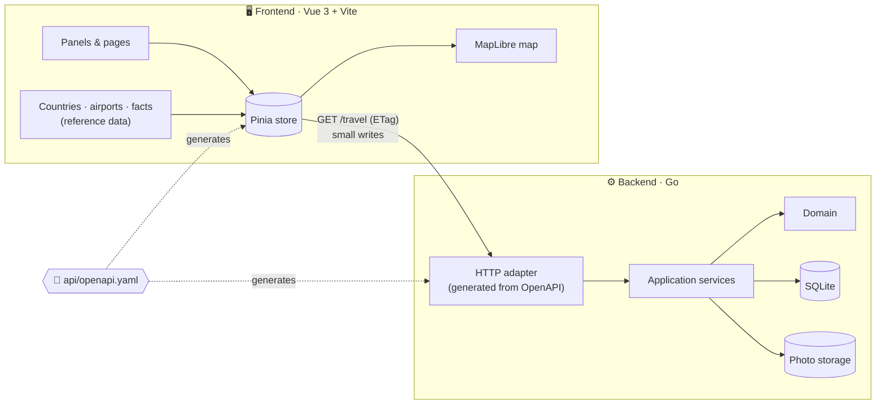
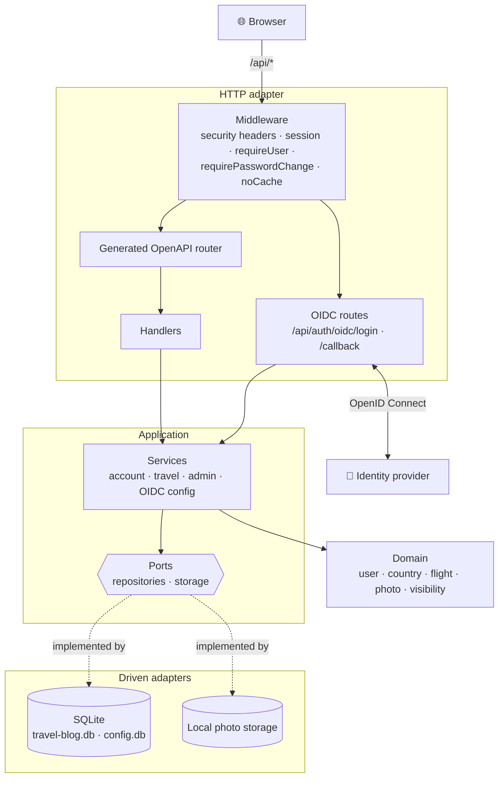
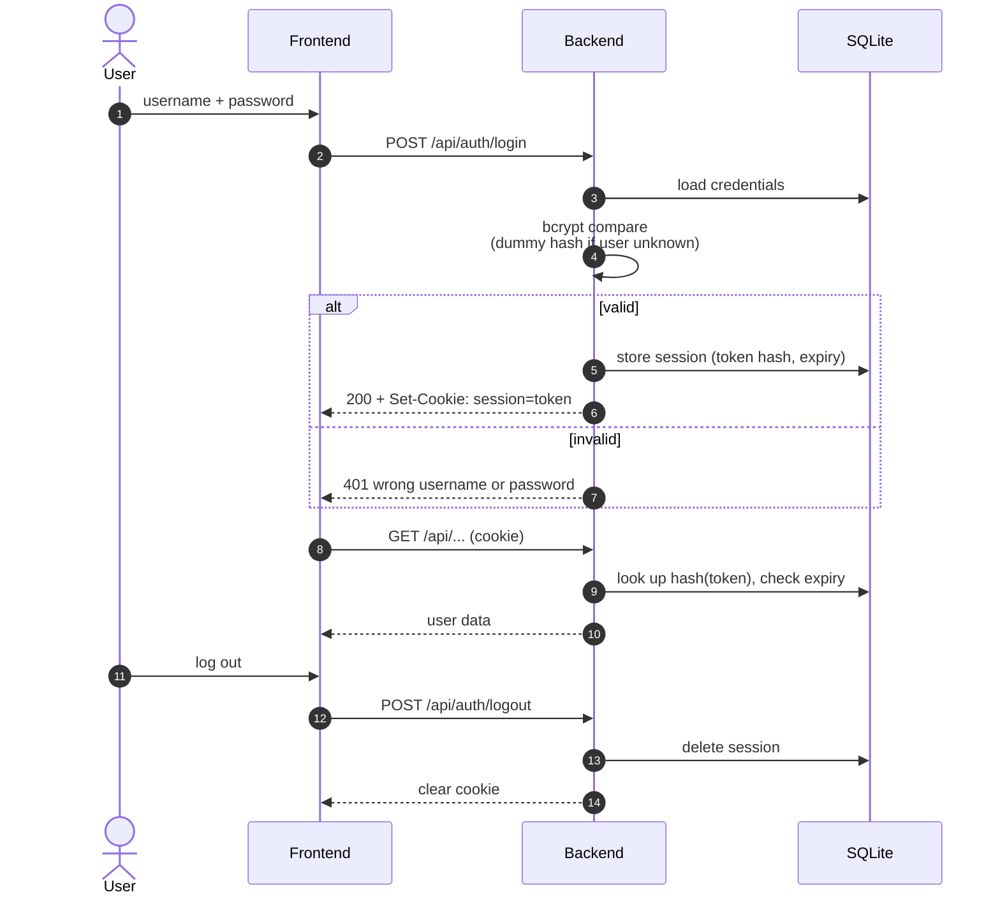
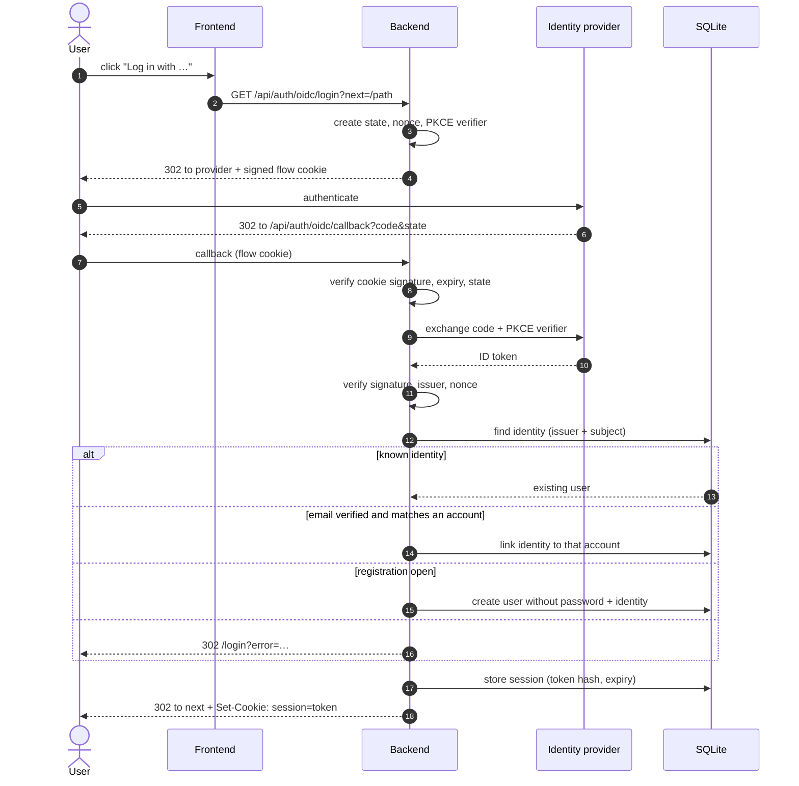
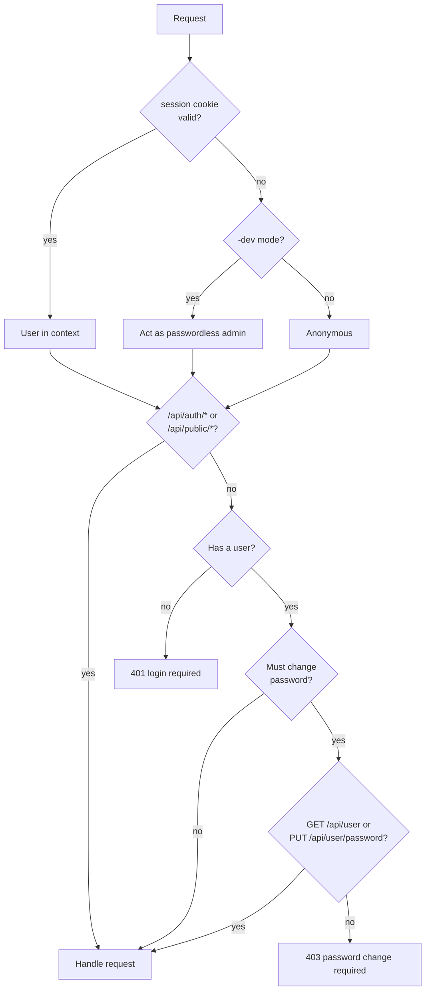

<div align="center">

# 🌍 Travel Blog

**Your travels on one map: the countries you've seen, the ones you dream of, and every flight in between.**

[](https://go.dev)
[](https://vuejs.org)
[](https://www.typescriptlang.org)
[](https://vite.dev)
[](https://maplibre.org)
[](https://sqlite.org)
[](api/README.md)
[](frontend/vite.config.ts)

<br>


</div>

<br>

## ✨ Features

<table>
<tr>
<td width="50%" valign="top">

### 🗺️ Countries

- **Visited** countries glow gold, **want to go** ones are outlined in violet
- Search any country, filter by your own tags
- Per-country notes: food, sightseeing, free text, ⭐ rating
- Facts and flags for every country, all kept in the client

</td>
<td width="50%" valign="top">

### ✈️ Flights

- Add routes by airport or IATA code
- Curved routes with labels drawn right on the map
- Distances per flight, total km and _× around the world_
- A flight marks both countries as visited automatically
- Optional flight number with a Flightradar24 link; date, duration (estimated from the distance until you enter it) and aircraft type filled in by hand. No external flight-data service, no API key

</td>
</tr>
<tr>
<td width="50%" valign="top">

### 👤 Accounts

- One form to log in or sign up: the username decides which; email is optional
- Roles: the first start creates an `admin` account with a generated password; administrators manage users and can close registration
- Optional single sign-on with any OpenID Connect provider, e.g. [Pocket ID](docs/oidc.md)
- Profile with home country and home airport
- Settings for km / mi, theme and start view
- English, German, Spanish and Russian: the profile language wins, otherwise the browser's; visitors pick one on the login page. Country, capital and airport names, dates and numbers follow the language

</td>
<td width="50%" valign="top">

### 🔓 Sharing

- Every entry and flight is `private` or `public`; a public flight shows its route only, never its number, date or aircraft
- A public profile shows your public travels at `/public/{username}`
- Installable as a Progressive Web App; works on phones and tablets and [offline](#-mobile-and-offline)

</td>
</tr>
</table>

<div align="center">

</div>

## 🚀 Getting started

**You need** [Go 1.26+](https://go.dev/dl/) and [Node.js 20.19+](https://nodejs.org).

```bash
npm install
```

Installs the root tooling and `frontend/` in one go.

```bash
npm run dev
```

Starts both servers side by side:

| Service     | URL                     |
| ----------- | ----------------------- |
| 🎨 Frontend | <http://localhost:5173> |
| ⚙️ Backend  | <http://localhost:8080> |

> [!TIP]
> In development the backend runs with `-dev`: requests without a session act as the passwordless administrator `admin`. Without `-dev` (production) `admin` gets a random password in `data/initial-admin.txt` and has to change it at the first login.

## 🧭 How it fits together



- **Lean on the wire.** The client loads `GET /api/user`, `/api/countries` and `/api/flights` in parallel (each cached via its own `ETag`; country texts come per country from `GET /api/countries/{iso}`) and applies its own writes locally. Reference data such as countries and airports never leaves the client.
- **Contract first.** [`api/openapi.yaml`](api/README.md) is the single source of truth. Go server code and TypeScript types are generated from it.
- **Hexagonal backend.** Domain, ports and services don't know about HTTP or SQLite, so either side can be swapped out.

### Backend layers



## 🔐 Authentication

Every request carries an opaque `session` cookie (`HttpOnly`, `Secure`, `SameSite=Lax`, path `/api`). Only the SHA-256 hash of the token is stored, so a leaked database cannot be replayed as a login.

### Password login



### Single sign-on (OpenID Connect)

Authorization code flow with PKCE (S256), `state` and `nonce`. The flow state lives in a short-lived, HMAC-signed cookie that is valid only once.



### Request authorization



## 📱 Mobile and offline

The layout is mobile first: phones (below 600px) get a bottom sheet for the
country and flight panels, tablets (600–1023px) a side sheet, desktops the
floating panels. Breakpoints and shared sizes are in
[`frontend/src/style.css`](frontend/src/style.css); the sheet is
[`AppSheet.vue`](frontend/src/components/ui/AppSheet.vue).

Offline, the installed app starts from its service worker and a logged-in user
stays logged in:

- After every successful load the store keeps a snapshot of the account and
  travel data in `localStorage`
  ([`snapshot.ts`](frontend/src/components/stores/snapshot.ts)). Without a
  connection (or when the server does not answer within 8 seconds) the app
  shows that snapshot.
- Offline the app is read-only: saving, flights, account and admin changes,
  log-in and log-out are disabled until the connection returns. Nothing is
  queued.
- Back online the app reloads its data. Only a `401` from the server ends the
  session; it also deletes the snapshot, as do logging out and deleting the
  account.
- Map style and tiles already viewed are cached by the service worker.

Safari deletes stored data of websites that were not used for seven days. The
installed app (Add to Home Screen) is not affected, so offline start is only
guaranteed there.

### Third-party licenses

`npm --prefix frontend run build` writes `third-party-licenses.txt` next to
`index.html`, with the license text of every package that reaches the browser
(see [`frontend/licenses.ts`](frontend/licenses.ts)). The account page links
to it.

## 📁 Project structure

```text
travel-blog/
├── api/                    📜 OpenAPI contract, split into paths/ and components/
├── backend/                ⚙️ Go API server
│   ├── cmd/api/              entry point
│   ├── internal/
│   │   ├── domain/           business models
│   │   ├── application/      ports and services (use cases)
│   │   └── adapter/          http, sqlite repository, file storage
│   └── migrations/           SQL schema: data/ and config/
├── frontend/               🎨 Vue 3 + TypeScript app
│   ├── generated/            types generated from the contract
│   └── src/components/       worldmap, countries, flights, account, …
└── docs/                   🖼️ screenshots
```

## 🛠️ Common tasks

| Task                     | Command                                       |
| ------------------------ | --------------------------------------------- |
| Run backend and frontend | `npm run dev`                                 |
| Regenerate API code      | `npm run generate:api`                        |
| Lint the API contract    | `npx redocly lint api/openapi.yaml`           |
| Backend tests            | `cd backend && go test ./...`                 |
| Type-check the frontend  | `npm --prefix frontend run type-check`        |
| Build the frontend       | `npm --prefix frontend run build`             |
| Format frontend code     | `cd frontend && npx prettier --write <files>` |
| Regenerate the PWA icons | `npm --prefix frontend run generate:icons`    |
| Refresh translated names | `cd frontend && node scripts/i18n-data.ts`    |

More detail lives next to the code: [`api/`](api/README.md) · [`backend/`](backend/README.md) · [`frontend/`](frontend/README.md) · [`proxmox/`](proxmox/README.md) (LXC helper script)

## 🤝 Contributing

- **Branches:** `<feat|fix>/<name>`, e.g. `feat/readme` or `fix/route-contrast`
- **Commits:** [Conventional Commits](https://www.conventionalcommits.org), e.g. `fix(frontend): show wishlist countries in violet`
- **API changes:** edit the contract, run `npm run generate:api` and commit the generated files with it

<div align="center">
<br>
<sub>Built with Go, Vue and a lot of wanderlust ✈️</sub>
</div>
