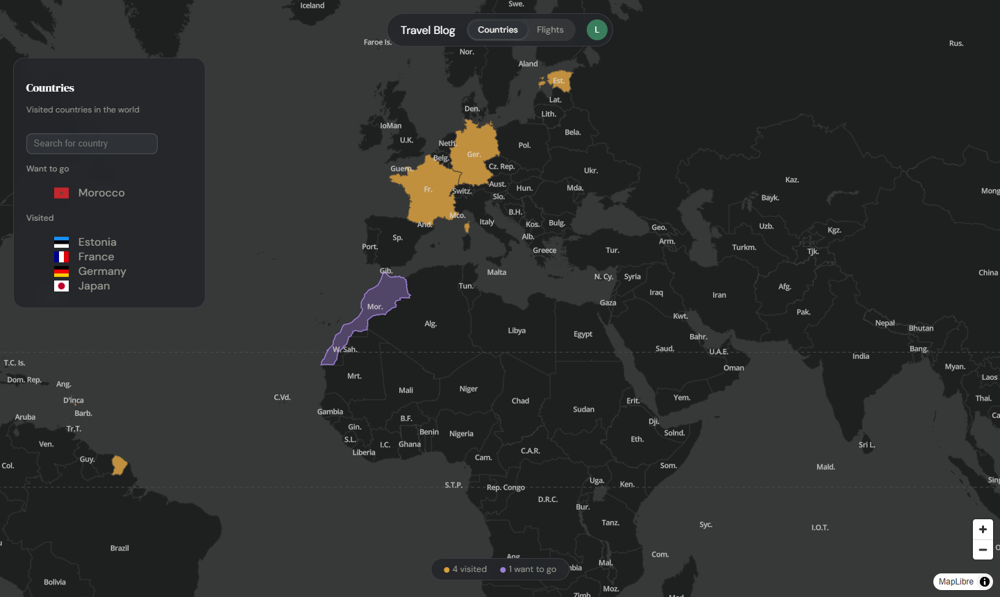

<div align="center">


# Travel Blog

**Your travels on one map: the countries you've seen, the ones you dream of, and every flight in between.**

[](https://go.dev)
[](https://vuejs.org)
[](https://www.typescriptlang.org)
[](https://vite.dev)
[](https://maplibre.org)
[](https://sqlite.org)
[](api/README.md)
[](frontend/vite.config.ts)

<br>





<details>
<summary>Contents</summary>

[Features](#-features) · [Getting started](#-getting-started) · [Architecture](#-architecture) · [Mobile and offline](#-mobile-and-offline) · [Project structure](#-project-structure)

</details>

</div>

## ✨ Features

- **Countries:** visited ones glow gold, wishlist ones are outlined in violet. Search, tags, notes, ratings, flags and facts for every country.
- **Flights:** add routes by airport or IATA code. Curved routes on the map, distances per flight and in total. A flight marks both countries as visited. No external flight-data service or API key.
- **Accounts:** one form to log in or sign up. The first start creates an `admin` account; administrators manage users and can close registration. Optional single sign-on with any OpenID Connect provider, e.g. [Pocket ID](docs/oidc.md).
- **Sharing:** every entry and flight is `private` or `public`. A public profile lives at `/public/{username}`; a public flight shows its route only.
- **Languages:** English, German, Spanish and Russian, including country, airport and number formats.
- **Installable:** a Progressive Web App for phones and tablets that also works [offline](#-mobile-and-offline).

## 🚀 Getting started

**You need** [Go 1.27.3+](https://go.dev/dl/) and [Node.js 26.12.1+](https://nodejs.org).

```bash
npm install
npm run dev
```

This installs the root tooling and `frontend/`, then starts the frontend on <http://localhost:5173> and the backend on <http://localhost:8080>.

> [!TIP]
> In development the backend runs with `-dev`: requests without a session act as the passwordless administrator `admin`. Without `-dev` (production) `admin` gets a random password in `data/initial-admin.txt` and has to change it at the first login.

## 🧭 Architecture

- **Contract first.** [`api/openapi.yaml`](api/README.md) is the single source of truth; the Go server code and the TypeScript types are generated from it.
- **Hexagonal backend.** Domain, ports and services don't know about HTTP or SQLite.
- **Lean client.** The frontend caches each resource by `ETag` and applies its own writes locally. Reference data such as countries and airports never leaves the client.
- **Sessions.** An opaque `HttpOnly` cookie; only the hash of the token is stored.

Diagrams of the components, the backend layers, password login, single sign-on and request authorization: **[docs/architecture.md](docs/architecture.md)**.

## 📱 Mobile and offline

The layout is mobile first: phones get a bottom sheet for the country and flight panels, tablets a side sheet, desktops floating panels.

Offline, the installed app starts from its service worker and a logged-in user stays logged in. The store keeps a snapshot of the account and travel data ([`snapshot.ts`](frontend/src/components/stores/snapshot.ts)) and shows it without a connection. The app is read-only offline; nothing is queued. Map style and tiles already viewed are cached too.

Safari deletes the data of websites not used for seven days. The installed app (Add to Home Screen) is not affected, so offline start is only guaranteed there.

`npm --prefix frontend run build` also writes `third-party-licenses.txt` with the license text of every package that reaches the browser (see [`frontend/licenses.ts`](frontend/licenses.ts)); the account and admin pages link to it.

## 📁 Project structure

```text
travel-blog/
├── api/         OpenAPI contract
├── backend/     Go API server (domain, application, adapters, migrations)
├── frontend/    Vue 3 + TypeScript app
├── docs/        guides and screenshot
└── proxmox/     LXC helper script
```

More detail lives next to the code: [`api/`](api/README.md) · [`backend/`](backend/README.md) · [`frontend/`](frontend/README.md) · [`proxmox/`](proxmox/README.md)
