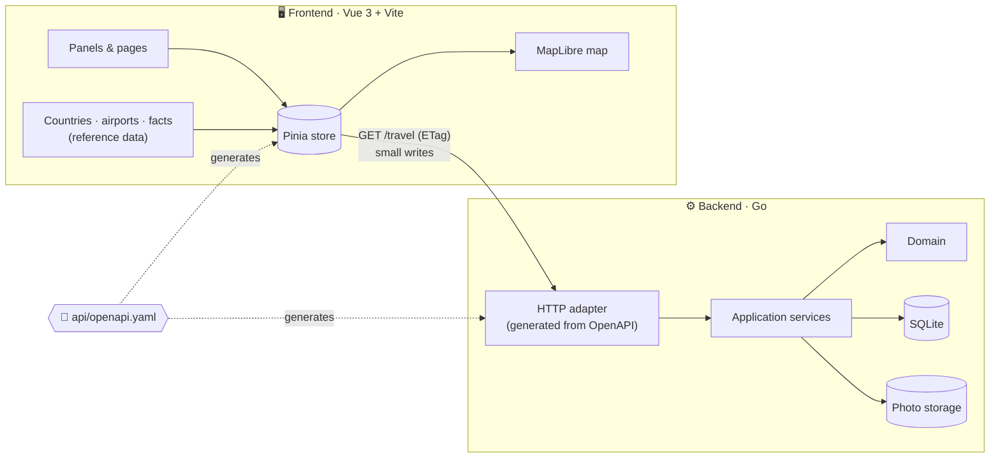

<div align="center">

# 🌍 Travel Blog

**Your travels on one map: the countries you've seen, the ones you dream of, and every flight in between.**

[](https://go.dev)
[](https://vuejs.org)
[](https://www.typescriptlang.org)
[](https://vite.dev)
[](https://maplibre.org)
[](https://sqlite.org)
[](api/README.md)
[](frontend/vite.config.ts)

<br>


</div>

<br>

## ✨ Features

<table>
<tr>
<td width="50%" valign="top">

### 🗺️ Countries

- **Visited** countries glow gold, **want to go** ones are outlined in violet
- Search any country, filter by your own tags
- Per-country notes: food, sightseeing, free text, ⭐ rating
- Facts and flags for every country, all kept in the client

</td>
<td width="50%" valign="top">

### ✈️ Flights

- Add routes by airport or IATA code
- Curved routes with labels drawn right on the map
- Distances per flight, total km and _× around the world_
- A flight marks both countries as visited automatically

</td>
</tr>
<tr>
<td width="50%" valign="top">

### 👤 Accounts

- One form to log in or sign up: the username decides which; email is optional
- Roles: the first start creates an `admin` account with a generated password; administrators manage users and can close registration
- Optional single sign-on with any OpenID Connect provider, e.g. [Pocket ID](docs/oidc.md)
- Profile with home country and home airport
- Settings for km / mi, theme and start view

</td>
<td width="50%" valign="top">

### 🔓 Sharing

- Every entry and flight is `private` or `public`
- A public profile shows your public travels at `/public/{username}`
- Installable as a Progressive Web App

</td>
</tr>
</table>

<div align="center">

</div>

## 🚀 Getting started

**You need** [Go 1.26+](https://go.dev/dl/) and [Node.js 20.19+](https://nodejs.org).

```bash
npm install
```

Installs the root tooling and `frontend/` in one go.

```bash
npm run dev
```

Starts both servers side by side:

| Service     | URL                     |
| ----------- | ----------------------- |
| 🎨 Frontend | <http://localhost:5173> |
| ⚙️ Backend  | <http://localhost:8080> |

> [!TIP]
> In development the backend runs with `-dev`: requests without a session act as the passwordless administrator `admin`. Without `-dev` (production) `admin` gets a random password in `data/initial-admin.txt` and has to change it at the first login.

## 🧭 How it fits together



- **Lean on the wire.** The client loads `GET /api/user`, `/api/countries` and `/api/flights` in parallel (each cached via its own `ETag`; country texts come per country from `GET /api/countries/{iso}`) and applies its own writes locally. Reference data such as countries and airports never leaves the client.
- **Contract first.** [`api/openapi.yaml`](api/README.md) is the single source of truth. Go server code and TypeScript types are generated from it.
- **Hexagonal backend.** Domain, ports and services don't know about HTTP or SQLite, so either side can be swapped out.

## 📁 Project structure

```text
travel-blog/
├── api/                    📜 OpenAPI contract, split into paths/ and components/
├── backend/                ⚙️ Go API server
│   ├── cmd/api/              entry point
│   ├── internal/
│   │   ├── domain/           business models
│   │   ├── application/      ports and services (use cases)
│   │   └── adapter/          http, sqlite repository, file storage
│   └── migrations/           SQL schema
├── frontend/               🎨 Vue 3 + TypeScript app
│   ├── generated/            types generated from the contract
│   └── src/components/       worldmap, countries, flights, account, …
└── docs/                   🖼️ screenshots
```

## 🛠️ Common tasks

| Task                     | Command                                       |
| ------------------------ | --------------------------------------------- |
| Run backend and frontend | `npm run dev`                                 |
| Regenerate API code      | `npm run generate:api`                        |
| Lint the API contract    | `npx redocly lint api/openapi.yaml`           |
| Backend tests            | `cd backend && go test ./...`                 |
| Type-check the frontend  | `npm --prefix frontend run type-check`        |
| Build the frontend       | `npm --prefix frontend run build`             |
| Format frontend code     | `cd frontend && npx prettier --write <files>` |

More detail lives next to the code: [`api/`](api/README.md) · [`backend/`](backend/README.md) · [`frontend/`](frontend/README.md) · [`proxmox/`](proxmox/README.md) (LXC helper script)

## 🤝 Contributing

- **Branches:** `<feat|fix>/<name>`, e.g. `feat/readme` or `fix/route-contrast`
- **Commits:** [Conventional Commits](https://www.conventionalcommits.org), e.g. `fix(frontend): show wishlist countries in violet`
- **API changes:** edit the contract, run `npm run generate:api` and commit the generated files with it

<div align="center">
<br>
<sub>Built with Go, Vue and a lot of wanderlust ✈️</sub>
</div>
