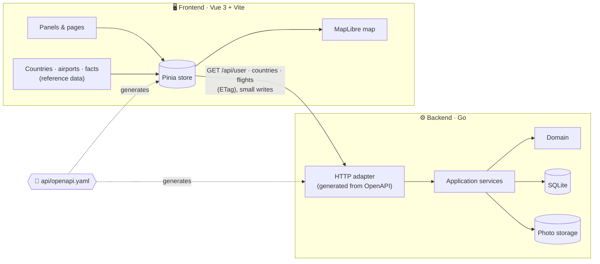
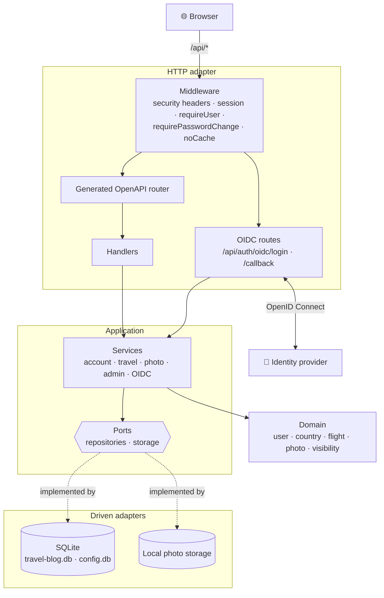
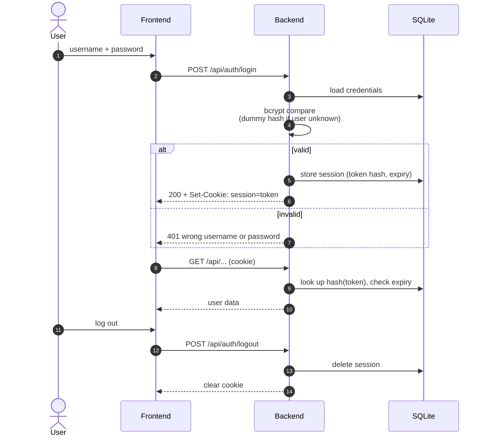
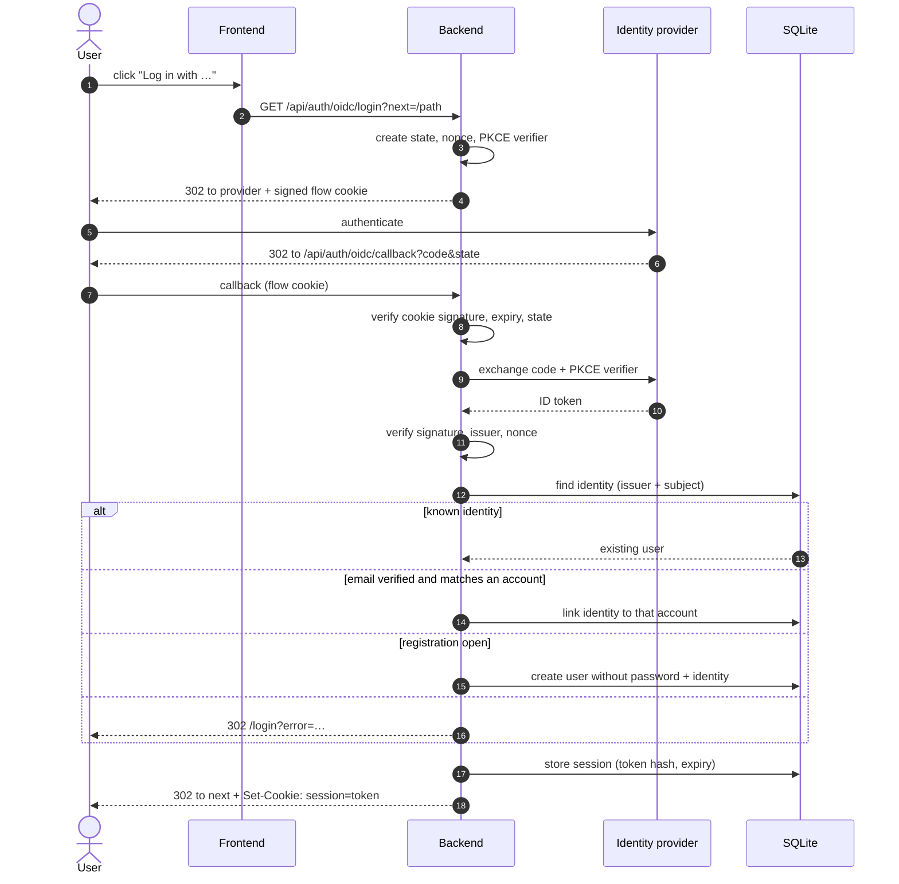
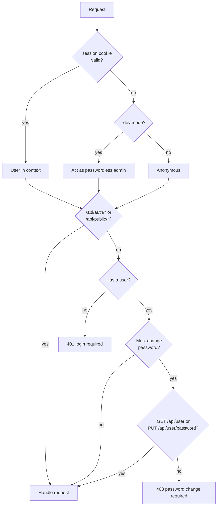

# Architecture

Diagrams for [the README](../README.md).

- [How it fits together](#how-it-fits-together)
- [Backend layers](#backend-layers)
- [Authentication](#authentication)

## How it fits together

## Backend layers

## Authentication

Every request carries an opaque `session` cookie (`HttpOnly`, `Secure`, `SameSite=Lax`, path `/api`). Only the SHA-256 hash of the token is stored, so a leaked database cannot be replayed as a login.

### Password login

### Single sign-on (OpenID Connect)

Authorization code flow with PKCE (S256), `state` and `nonce`. The flow state lives in a short-lived, HMAC-signed cookie that is valid only once.

### Request authorization

